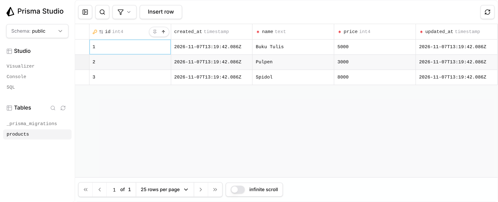
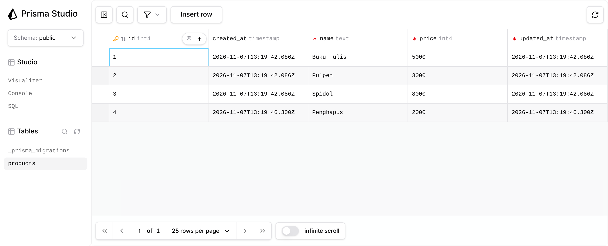
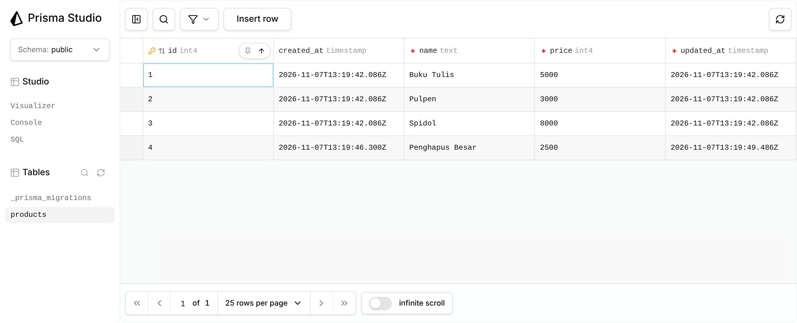
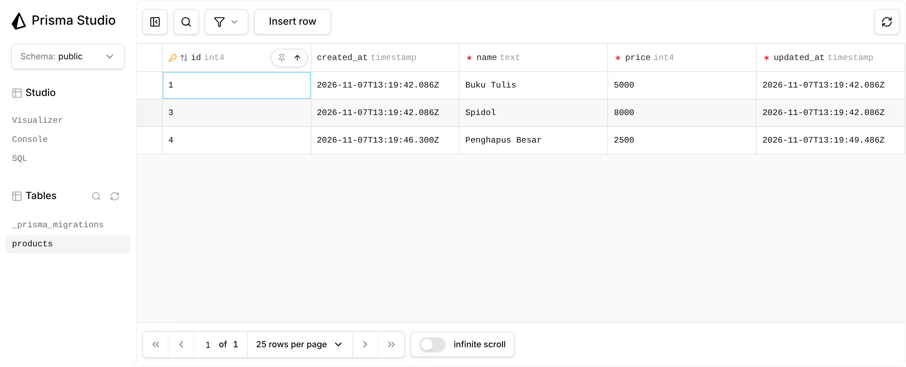
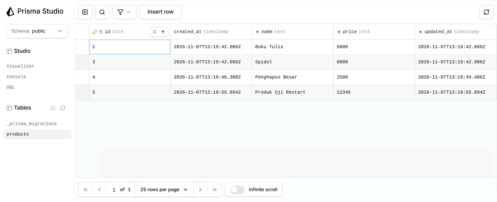

# Laporan Pengujian — API Produk ExpressJS + Prisma + PostgreSQL

Laporan ini dihasilkan otomatis oleh `npm run evidence` (`scripts/evidence.js`). Setiap request dikirim ke server ExpressJS
yang berjalan sungguhan, dan isi tabel `products` dibaca langsung dari PostgreSQL (`SELECT` melalui Prisma) sebelum dan sesudah request.

- Dijalankan pada: 2026-11-07T13:20:14.259Z
- Stack: Node.js v22.23.4, Express 5, Prisma 7, PostgreSQL 16
- **Hasil: 18 dari 18 skenario lulus**

## 1. Ringkasan skenario

| ID | Skenario | Method & path | Status | Harapan | Hasil |
|---|---|---|---|---|---|
| S01 | GET semua produk (sukses) | `GET /products` | 200 | 200 | LULUS |
| S02 | GET produk berdasarkan id (sukses) | `GET /products/2` | 200 | 200 | LULUS |
| S03 | GET produk dengan id yang tidak ada | `GET /products/9999` | 404 | 404 | LULUS |
| S04 | GET produk dengan id bukan angka | `GET /products/abc` | 400 | 400 | LULUS |
| S05 | POST produk baru (sukses) | `POST /products` | 201 | 201 | LULUS |
| S06 | POST tanpa field name (validasi gagal) | `POST /products` | 400 | 400 | LULUS |
| S07 | POST dengan price berupa teks (validasi gagal) | `POST /products` | 400 | 400 | LULUS |
| S08 | POST dengan price negatif dan name kosong (dua kesalahan sekaligus) | `POST /products` | 400 | 400 | LULUS |
| S09 | POST dengan body bukan JSON valid | `POST /products` | 400 | 400 | LULUS |
| S10 | PUT mengubah produk (sukses) | `PUT /products` | 200 | 200 | LULUS |
| S11 | PUT tanpa id (validasi gagal) | `PUT /products` | 400 | 400 | LULUS |
| S12 | PUT dengan id yang tidak ada | `PUT /products` | 404 | 404 | LULUS |
| S13 | PUT dengan name/price tidak valid | `PUT /products` | 400 | 400 | LULUS |
| S14 | DELETE produk (sukses) | `DELETE /products/4` | 200 | 200 | LULUS |
| S15 | DELETE produk yang sudah terhapus / tidak ada | `DELETE /products/4` | 404 | 404 | LULUS |
| S16 | DELETE dengan id tidak valid | `DELETE /products/-1` | 400 | 400 | LULUS |
| S17 | Uji restart — langkah 1: POST produk baru | `POST /products` | 201 | 201 | LULUS |
| S18 | Uji restart — langkah 2: GET setelah server dimulai ulang | `GET /products` | 200 | 200 | LULUS |

## 2. Data awal di database

Tabel `products` dikosongkan (`TRUNCATE ... RESTART IDENTITY`) lalu diisi tiga baris:

| id | name | price | created_at | updated_at |
|---|---|---|---|---|
| 1 | Buku Tulis | 5000 | 2026-11-07 13:20:13 | 2026-11-07 13:20:13 |
| 2 | Pulpen | 3000 | 2026-11-07 13:20:13 | 2026-11-07 13:20:13 |
| 3 | Spidol | 8000 | 2026-11-07 13:20:13 | 2026-11-07 13:20:13 |

_(3 baris)_

## 3. Detail skenario (request, response, perubahan database)

### S01 — GET semua produk (sukses)

**Request**
```bash
curl -i -X GET http://localhost:3000/products
```

**Response** — HTTP `200` (harapan: `200`) → **LULUS**
```json
[
  {
    "id": 1,
    "name": "Buku Tulis",
    "price": 5000,
    "createdAt": "2026-11-07T13:20:13.580Z",
    "updatedAt": "2026-11-07T13:20:13.580Z"
  },
  {
    "id": 2,
    "name": "Pulpen",
    "price": 3000,
    "createdAt": "2026-11-07T13:20:13.580Z",
    "updatedAt": "2026-11-07T13:20:13.580Z"
  },
  {
    "id": 3,
    "name": "Spidol",
    "price": 8000,
    "createdAt": "2026-11-07T13:20:13.580Z",
    "updatedAt": "2026-11-07T13:20:13.580Z"
  }
]
```

---

### S02 — GET produk berdasarkan id (sukses)

**Request**
```bash
curl -i -X GET http://localhost:3000/products/2
```

**Response** — HTTP `200` (harapan: `200`) → **LULUS**
```json
{
  "id": 2,
  "name": "Pulpen",
  "price": 3000,
  "createdAt": "2026-11-07T13:20:13.580Z",
  "updatedAt": "2026-11-07T13:20:13.580Z"
}
```

---

### S03 — GET produk dengan id yang tidak ada

**Request**
```bash
curl -i -X GET http://localhost:3000/products/9999
```

**Response** — HTTP `404` (harapan: `404`) → **LULUS**
```json
{
  "error": "Produk dengan id 9999 tidak ditemukan"
}
```

---

### S04 — GET produk dengan id bukan angka

**Request**
```bash
curl -i -X GET http://localhost:3000/products/abc
```

**Response** — HTTP `400` (harapan: `400`) → **LULUS**
```json
{
  "error": "Validasi gagal",
  "details": [
    "id harus berupa bilangan bulat positif"
  ]
}
```

---

### S05 — POST produk baru (sukses)

**Request**
```bash
curl -i -X POST http://localhost:3000/products \
  -H "Content-Type: application/json" \
  -d '{"name":"Penghapus","price":2000}'
```

**Response** — HTTP `201` (harapan: `201`) → **LULUS**
```json
{
  "id": 4,
  "name": "Penghapus",
  "price": 2000,
  "createdAt": "2026-11-07T13:20:13.903Z",
  "updatedAt": "2026-11-07T13:20:13.903Z"
}
```

**Database sebelum (`SELECT * FROM products`)**

| id | name | price | created_at | updated_at |
|---|---|---|---|---|
| 1 | Buku Tulis | 5000 | 2026-11-07 13:20:13 | 2026-11-07 13:20:13 |
| 2 | Pulpen | 3000 | 2026-11-07 13:20:13 | 2026-11-07 13:20:13 |
| 3 | Spidol | 8000 | 2026-11-07 13:20:13 | 2026-11-07 13:20:13 |

_(3 baris)_

**Database sesudah**

| id | name | price | created_at | updated_at |
|---|---|---|---|---|
| 1 | Buku Tulis | 5000 | 2026-11-07 13:20:13 | 2026-11-07 13:20:13 |
| 2 | Pulpen | 3000 | 2026-11-07 13:20:13 | 2026-11-07 13:20:13 |
| 3 | Spidol | 8000 | 2026-11-07 13:20:13 | 2026-11-07 13:20:13 |
| 4 | Penghapus | 2000 | 2026-11-07 13:20:13 | 2026-11-07 13:20:13 |

_(4 baris)_

---

### S06 — POST tanpa field name (validasi gagal)

**Request**
```bash
curl -i -X POST http://localhost:3000/products \
  -H "Content-Type: application/json" \
  -d '{"price":2000}'
```

**Response** — HTTP `400` (harapan: `400`) → **LULUS**
```json
{
  "error": "Validasi gagal",
  "details": [
    "name wajib diisi dan berupa teks tidak kosong"
  ]
}
```

**Database sebelum (`SELECT * FROM products`)**

| id | name | price | created_at | updated_at |
|---|---|---|---|---|
| 1 | Buku Tulis | 5000 | 2026-11-07 13:20:13 | 2026-11-07 13:20:13 |
| 2 | Pulpen | 3000 | 2026-11-07 13:20:13 | 2026-11-07 13:20:13 |
| 3 | Spidol | 8000 | 2026-11-07 13:20:13 | 2026-11-07 13:20:13 |
| 4 | Penghapus | 2000 | 2026-11-07 13:20:13 | 2026-11-07 13:20:13 |

_(4 baris)_

**Database sesudah**

| id | name | price | created_at | updated_at |
|---|---|---|---|---|
| 1 | Buku Tulis | 5000 | 2026-11-07 13:20:13 | 2026-11-07 13:20:13 |
| 2 | Pulpen | 3000 | 2026-11-07 13:20:13 | 2026-11-07 13:20:13 |
| 3 | Spidol | 8000 | 2026-11-07 13:20:13 | 2026-11-07 13:20:13 |
| 4 | Penghapus | 2000 | 2026-11-07 13:20:13 | 2026-11-07 13:20:13 |

_(4 baris)_

---

### S07 — POST dengan price berupa teks (validasi gagal)

**Request**
```bash
curl -i -X POST http://localhost:3000/products \
  -H "Content-Type: application/json" \
  -d '{"name":"Penggaris","price":"abc"}'
```

**Response** — HTTP `400` (harapan: `400`) → **LULUS**
```json
{
  "error": "Validasi gagal",
  "details": [
    "price wajib diisi dan berupa bilangan bulat"
  ]
}
```

**Database sebelum (`SELECT * FROM products`)**

| id | name | price | created_at | updated_at |
|---|---|---|---|---|
| 1 | Buku Tulis | 5000 | 2026-11-07 13:20:13 | 2026-11-07 13:20:13 |
| 2 | Pulpen | 3000 | 2026-11-07 13:20:13 | 2026-11-07 13:20:13 |
| 3 | Spidol | 8000 | 2026-11-07 13:20:13 | 2026-11-07 13:20:13 |
| 4 | Penghapus | 2000 | 2026-11-07 13:20:13 | 2026-11-07 13:20:13 |

_(4 baris)_

**Database sesudah**

| id | name | price | created_at | updated_at |
|---|---|---|---|---|
| 1 | Buku Tulis | 5000 | 2026-11-07 13:20:13 | 2026-11-07 13:20:13 |
| 2 | Pulpen | 3000 | 2026-11-07 13:20:13 | 2026-11-07 13:20:13 |
| 3 | Spidol | 8000 | 2026-11-07 13:20:13 | 2026-11-07 13:20:13 |
| 4 | Penghapus | 2000 | 2026-11-07 13:20:13 | 2026-11-07 13:20:13 |

_(4 baris)_

---

### S08 — POST dengan price negatif dan name kosong (dua kesalahan sekaligus)

**Request**
```bash
curl -i -X POST http://localhost:3000/products \
  -H "Content-Type: application/json" \
  -d '{"name":"","price":-100}'
```

**Response** — HTTP `400` (harapan: `400`) → **LULUS**
```json
{
  "error": "Validasi gagal",
  "details": [
    "name wajib diisi dan berupa teks tidak kosong",
    "price harus antara 0 dan 2147483647"
  ]
}
```

**Database sebelum (`SELECT * FROM products`)**

| id | name | price | created_at | updated_at |
|---|---|---|---|---|
| 1 | Buku Tulis | 5000 | 2026-11-07 13:20:13 | 2026-11-07 13:20:13 |
| 2 | Pulpen | 3000 | 2026-11-07 13:20:13 | 2026-11-07 13:20:13 |
| 3 | Spidol | 8000 | 2026-11-07 13:20:13 | 2026-11-07 13:20:13 |
| 4 | Penghapus | 2000 | 2026-11-07 13:20:13 | 2026-11-07 13:20:13 |

_(4 baris)_

**Database sesudah**

| id | name | price | created_at | updated_at |
|---|---|---|---|---|
| 1 | Buku Tulis | 5000 | 2026-11-07 13:20:13 | 2026-11-07 13:20:13 |
| 2 | Pulpen | 3000 | 2026-11-07 13:20:13 | 2026-11-07 13:20:13 |
| 3 | Spidol | 8000 | 2026-11-07 13:20:13 | 2026-11-07 13:20:13 |
| 4 | Penghapus | 2000 | 2026-11-07 13:20:13 | 2026-11-07 13:20:13 |

_(4 baris)_

---

### S09 — POST dengan body bukan JSON valid

**Request**
```bash
curl -i -X POST http://localhost:3000/products \
  -H "Content-Type: application/json" \
  -d '{"name": "Rusak", price: }'
```

**Response** — HTTP `400` (harapan: `400`) → **LULUS**
```json
{
  "error": "Body bukan JSON yang valid"
}
```

**Database sebelum (`SELECT * FROM products`)**

| id | name | price | created_at | updated_at |
|---|---|---|---|---|
| 1 | Buku Tulis | 5000 | 2026-11-07 13:20:13 | 2026-11-07 13:20:13 |
| 2 | Pulpen | 3000 | 2026-11-07 13:20:13 | 2026-11-07 13:20:13 |
| 3 | Spidol | 8000 | 2026-11-07 13:20:13 | 2026-11-07 13:20:13 |
| 4 | Penghapus | 2000 | 2026-11-07 13:20:13 | 2026-11-07 13:20:13 |

_(4 baris)_

**Database sesudah**

| id | name | price | created_at | updated_at |
|---|---|---|---|---|
| 1 | Buku Tulis | 5000 | 2026-11-07 13:20:13 | 2026-11-07 13:20:13 |
| 2 | Pulpen | 3000 | 2026-11-07 13:20:13 | 2026-11-07 13:20:13 |
| 3 | Spidol | 8000 | 2026-11-07 13:20:13 | 2026-11-07 13:20:13 |
| 4 | Penghapus | 2000 | 2026-11-07 13:20:13 | 2026-11-07 13:20:13 |

_(4 baris)_

---

### S10 — PUT mengubah produk (sukses)

**Request**
```bash
curl -i -X PUT http://localhost:3000/products \
  -H "Content-Type: application/json" \
  -d '{"id":4,"name":"Penghapus Besar","price":2500}'
```

**Response** — HTTP `200` (harapan: `200`) → **LULUS**
```json
{
  "id": 4,
  "name": "Penghapus Besar",
  "price": 2500,
  "createdAt": "2026-11-07T13:20:13.903Z",
  "updatedAt": "2026-11-07T13:20:13.935Z"
}
```

**Database sebelum (`SELECT * FROM products`)**

| id | name | price | created_at | updated_at |
|---|---|---|---|---|
| 1 | Buku Tulis | 5000 | 2026-11-07 13:20:13 | 2026-11-07 13:20:13 |
| 2 | Pulpen | 3000 | 2026-11-07 13:20:13 | 2026-11-07 13:20:13 |
| 3 | Spidol | 8000 | 2026-11-07 13:20:13 | 2026-11-07 13:20:13 |
| 4 | Penghapus | 2000 | 2026-11-07 13:20:13 | 2026-11-07 13:20:13 |

_(4 baris)_

**Database sesudah**

| id | name | price | created_at | updated_at |
|---|---|---|---|---|
| 1 | Buku Tulis | 5000 | 2026-11-07 13:20:13 | 2026-11-07 13:20:13 |
| 2 | Pulpen | 3000 | 2026-11-07 13:20:13 | 2026-11-07 13:20:13 |
| 3 | Spidol | 8000 | 2026-11-07 13:20:13 | 2026-11-07 13:20:13 |
| 4 | Penghapus Besar | 2500 | 2026-11-07 13:20:13 | 2026-11-07 13:20:13 |

_(4 baris)_

---

### S11 — PUT tanpa id (validasi gagal)

**Request**
```bash
curl -i -X PUT http://localhost:3000/products \
  -H "Content-Type: application/json" \
  -d '{"name":"Tanpa Id","price":1000}'
```

**Response** — HTTP `400` (harapan: `400`) → **LULUS**
```json
{
  "error": "Validasi gagal",
  "details": [
    "id wajib diisi dan berupa bilangan bulat positif"
  ]
}
```

**Database sebelum (`SELECT * FROM products`)**

| id | name | price | created_at | updated_at |
|---|---|---|---|---|
| 1 | Buku Tulis | 5000 | 2026-11-07 13:20:13 | 2026-11-07 13:20:13 |
| 2 | Pulpen | 3000 | 2026-11-07 13:20:13 | 2026-11-07 13:20:13 |
| 3 | Spidol | 8000 | 2026-11-07 13:20:13 | 2026-11-07 13:20:13 |
| 4 | Penghapus Besar | 2500 | 2026-11-07 13:20:13 | 2026-11-07 13:20:13 |

_(4 baris)_

**Database sesudah**

| id | name | price | created_at | updated_at |
|---|---|---|---|---|
| 1 | Buku Tulis | 5000 | 2026-11-07 13:20:13 | 2026-11-07 13:20:13 |
| 2 | Pulpen | 3000 | 2026-11-07 13:20:13 | 2026-11-07 13:20:13 |
| 3 | Spidol | 8000 | 2026-11-07 13:20:13 | 2026-11-07 13:20:13 |
| 4 | Penghapus Besar | 2500 | 2026-11-07 13:20:13 | 2026-11-07 13:20:13 |

_(4 baris)_

---

### S12 — PUT dengan id yang tidak ada

**Request**
```bash
curl -i -X PUT http://localhost:3000/products \
  -H "Content-Type: application/json" \
  -d '{"id":9999,"name":"Hantu","price":1000}'
```

**Response** — HTTP `404` (harapan: `404`) → **LULUS**
```json
{
  "error": "Produk dengan id 9999 tidak ditemukan"
}
```

**Database sebelum (`SELECT * FROM products`)**

| id | name | price | created_at | updated_at |
|---|---|---|---|---|
| 1 | Buku Tulis | 5000 | 2026-11-07 13:20:13 | 2026-11-07 13:20:13 |
| 2 | Pulpen | 3000 | 2026-11-07 13:20:13 | 2026-11-07 13:20:13 |
| 3 | Spidol | 8000 | 2026-11-07 13:20:13 | 2026-11-07 13:20:13 |
| 4 | Penghapus Besar | 2500 | 2026-11-07 13:20:13 | 2026-11-07 13:20:13 |

_(4 baris)_

**Database sesudah**

| id | name | price | created_at | updated_at |
|---|---|---|---|---|
| 1 | Buku Tulis | 5000 | 2026-11-07 13:20:13 | 2026-11-07 13:20:13 |
| 2 | Pulpen | 3000 | 2026-11-07 13:20:13 | 2026-11-07 13:20:13 |
| 3 | Spidol | 8000 | 2026-11-07 13:20:13 | 2026-11-07 13:20:13 |
| 4 | Penghapus Besar | 2500 | 2026-11-07 13:20:13 | 2026-11-07 13:20:13 |

_(4 baris)_

---

### S13 — PUT dengan name/price tidak valid

**Request**
```bash
curl -i -X PUT http://localhost:3000/products \
  -H "Content-Type: application/json" \
  -d '{"id":4,"name":123,"price":12.5}'
```

**Response** — HTTP `400` (harapan: `400`) → **LULUS**
```json
{
  "error": "Validasi gagal",
  "details": [
    "name wajib diisi dan berupa teks tidak kosong",
    "price wajib diisi dan berupa bilangan bulat"
  ]
}
```

**Database sebelum (`SELECT * FROM products`)**

| id | name | price | created_at | updated_at |
|---|---|---|---|---|
| 1 | Buku Tulis | 5000 | 2026-11-07 13:20:13 | 2026-11-07 13:20:13 |
| 2 | Pulpen | 3000 | 2026-11-07 13:20:13 | 2026-11-07 13:20:13 |
| 3 | Spidol | 8000 | 2026-11-07 13:20:13 | 2026-11-07 13:20:13 |
| 4 | Penghapus Besar | 2500 | 2026-11-07 13:20:13 | 2026-11-07 13:20:13 |

_(4 baris)_

**Database sesudah**

| id | name | price | created_at | updated_at |
|---|---|---|---|---|
| 1 | Buku Tulis | 5000 | 2026-11-07 13:20:13 | 2026-11-07 13:20:13 |
| 2 | Pulpen | 3000 | 2026-11-07 13:20:13 | 2026-11-07 13:20:13 |
| 3 | Spidol | 8000 | 2026-11-07 13:20:13 | 2026-11-07 13:20:13 |
| 4 | Penghapus Besar | 2500 | 2026-11-07 13:20:13 | 2026-11-07 13:20:13 |

_(4 baris)_

---

### S14 — DELETE produk (sukses)

**Request**
```bash
curl -i -X DELETE http://localhost:3000/products/4
```

**Response** — HTTP `200` (harapan: `200`) → **LULUS**
```json
{
  "message": "Produk dengan id 4 berhasil dihapus",
  "product": {
    "id": 4,
    "name": "Penghapus Besar",
    "price": 2500,
    "createdAt": "2026-11-07T13:20:13.903Z",
    "updatedAt": "2026-11-07T13:20:13.935Z"
  }
}
```

**Database sebelum (`SELECT * FROM products`)**

| id | name | price | created_at | updated_at |
|---|---|---|---|---|
| 1 | Buku Tulis | 5000 | 2026-11-07 13:20:13 | 2026-11-07 13:20:13 |
| 2 | Pulpen | 3000 | 2026-11-07 13:20:13 | 2026-11-07 13:20:13 |
| 3 | Spidol | 8000 | 2026-11-07 13:20:13 | 2026-11-07 13:20:13 |
| 4 | Penghapus Besar | 2500 | 2026-11-07 13:20:13 | 2026-11-07 13:20:13 |

_(4 baris)_

**Database sesudah**

| id | name | price | created_at | updated_at |
|---|---|---|---|---|
| 1 | Buku Tulis | 5000 | 2026-11-07 13:20:13 | 2026-11-07 13:20:13 |
| 2 | Pulpen | 3000 | 2026-11-07 13:20:13 | 2026-11-07 13:20:13 |
| 3 | Spidol | 8000 | 2026-11-07 13:20:13 | 2026-11-07 13:20:13 |

_(3 baris)_

---

### S15 — DELETE produk yang sudah terhapus / tidak ada

**Request**
```bash
curl -i -X DELETE http://localhost:3000/products/4
```

**Response** — HTTP `404` (harapan: `404`) → **LULUS**
```json
{
  "error": "Produk dengan id 4 tidak ditemukan"
}
```

**Database sebelum (`SELECT * FROM products`)**

| id | name | price | created_at | updated_at |
|---|---|---|---|---|
| 1 | Buku Tulis | 5000 | 2026-11-07 13:20:13 | 2026-11-07 13:20:13 |
| 2 | Pulpen | 3000 | 2026-11-07 13:20:13 | 2026-11-07 13:20:13 |
| 3 | Spidol | 8000 | 2026-11-07 13:20:13 | 2026-11-07 13:20:13 |

_(3 baris)_

**Database sesudah**

| id | name | price | created_at | updated_at |
|---|---|---|---|---|
| 1 | Buku Tulis | 5000 | 2026-11-07 13:20:13 | 2026-11-07 13:20:13 |
| 2 | Pulpen | 3000 | 2026-11-07 13:20:13 | 2026-11-07 13:20:13 |
| 3 | Spidol | 8000 | 2026-11-07 13:20:13 | 2026-11-07 13:20:13 |

_(3 baris)_

---

### S16 — DELETE dengan id tidak valid

**Request**
```bash
curl -i -X DELETE http://localhost:3000/products/-1
```

**Response** — HTTP `400` (harapan: `400`) → **LULUS**
```json
{
  "error": "Validasi gagal",
  "details": [
    "id harus berupa bilangan bulat positif"
  ]
}
```

**Database sebelum (`SELECT * FROM products`)**

| id | name | price | created_at | updated_at |
|---|---|---|---|---|
| 1 | Buku Tulis | 5000 | 2026-11-07 13:20:13 | 2026-11-07 13:20:13 |
| 2 | Pulpen | 3000 | 2026-11-07 13:20:13 | 2026-11-07 13:20:13 |
| 3 | Spidol | 8000 | 2026-11-07 13:20:13 | 2026-11-07 13:20:13 |

_(3 baris)_

**Database sesudah**

| id | name | price | created_at | updated_at |
|---|---|---|---|---|
| 1 | Buku Tulis | 5000 | 2026-11-07 13:20:13 | 2026-11-07 13:20:13 |
| 2 | Pulpen | 3000 | 2026-11-07 13:20:13 | 2026-11-07 13:20:13 |
| 3 | Spidol | 8000 | 2026-11-07 13:20:13 | 2026-11-07 13:20:13 |

_(3 baris)_

---

### S17 — Uji restart — langkah 1: POST produk baru

**Request**
```bash
curl -i -X POST http://localhost:3000/products \
  -H "Content-Type: application/json" \
  -d '{"name":"Produk Uji Restart","price":12345}'
```

**Response** — HTTP `201` (harapan: `201`) → **LULUS**
```json
{
  "id": 5,
  "name": "Produk Uji Restart",
  "price": 12345,
  "createdAt": "2026-11-07T13:20:13.976Z",
  "updatedAt": "2026-11-07T13:20:13.976Z"
}
```

**Database sebelum (`SELECT * FROM products`)**

| id | name | price | created_at | updated_at |
|---|---|---|---|---|
| 1 | Buku Tulis | 5000 | 2026-11-07 13:20:13 | 2026-11-07 13:20:13 |
| 2 | Pulpen | 3000 | 2026-11-07 13:20:13 | 2026-11-07 13:20:13 |
| 3 | Spidol | 8000 | 2026-11-07 13:20:13 | 2026-11-07 13:20:13 |

_(3 baris)_

**Database sesudah**

| id | name | price | created_at | updated_at |
|---|---|---|---|---|
| 1 | Buku Tulis | 5000 | 2026-11-07 13:20:13 | 2026-11-07 13:20:13 |
| 2 | Pulpen | 3000 | 2026-11-07 13:20:13 | 2026-11-07 13:20:13 |
| 3 | Spidol | 8000 | 2026-11-07 13:20:13 | 2026-11-07 13:20:13 |
| 5 | Produk Uji Restart | 12345 | 2026-11-07 13:20:13 | 2026-11-07 13:20:13 |

_(4 baris)_

---

### S18 — Uji restart — langkah 2: GET setelah server dimulai ulang

**Request**
```bash
curl -i -X GET http://localhost:3000/products
```

**Response** — HTTP `200` (harapan: `200`) → **LULUS**
```json
[
  {
    "id": 1,
    "name": "Buku Tulis",
    "price": 5000,
    "createdAt": "2026-11-07T13:20:13.580Z",
    "updatedAt": "2026-11-07T13:20:13.580Z"
  },
  {
    "id": 2,
    "name": "Pulpen",
    "price": 3000,
    "createdAt": "2026-11-07T13:20:13.580Z",
    "updatedAt": "2026-11-07T13:20:13.580Z"
  },
  {
    "id": 3,
    "name": "Spidol",
    "price": 8000,
    "createdAt": "2026-11-07T13:20:13.580Z",
    "updatedAt": "2026-11-07T13:20:13.580Z"
  },
  {
    "id": 5,
    "name": "Produk Uji Restart",
    "price": 12345,
    "createdAt": "2026-11-07T13:20:13.976Z",
    "updatedAt": "2026-11-07T13:20:13.976Z"
  }
]
```

---

## 4. Uji restart ExpressJS (bukti data tersimpan di database)

Prosedur yang dijalankan:

1. **S17** — `POST /products` membuat produk id **5** (`Produk Uji Restart`).
2. `GET /products` sebelum restart mengembalikan **4** produk.
3. Proses ExpressJS dihentikan (`SIGTERM`), lalu dijalankan kembali sebagai proses baru.
4. **S18** — `GET /products` dipanggil lagi.

Hasil: produk id **5** **masih tersedia** setelah restart
(response S18 berisi 4 produk).
Pada versi minggu ke-9 (array di memori) produk ini akan hilang, karena array kembali ke nilai awal saat proses dimulai ulang.

Isi tabel `products` di PostgreSQL pada akhir pengujian:

| id | name | price | created_at | updated_at |
|---|---|---|---|---|
| 1 | Buku Tulis | 5000 | 2026-11-07 13:20:13 | 2026-11-07 13:20:13 |
| 2 | Pulpen | 3000 | 2026-11-07 13:20:13 | 2026-11-07 13:20:13 |
| 3 | Spidol | 8000 | 2026-11-07 13:20:13 | 2026-11-07 13:20:13 |
| 5 | Produk Uji Restart | 12345 | 2026-11-07 13:20:13 | 2026-11-07 13:20:13 |

_(4 baris)_

## 5. Screenshot Prisma Studio (before — after)

Diambil dari Prisma Studio (`npm run studio`, tabel `products`) pada database PostgreSQL yang sama dengan server.
Urutan operasi: data awal → POST → PUT → DELETE → POST produk uji → restart ExpressJS.

| Tahap | Screenshot |
|---|---|
| 1. Sebelum (3 produk: id 1, 2, 3) |  |
| 2. Sesudah `POST` (id 4 `Penghapus` ditambahkan) |  |
| 3. Sesudah `PUT` (id 4 menjadi `Penghapus Besar`, 2500) |  |
| 4. Sesudah `DELETE /products/2` (id 2 `Pulpen` hilang) |  |
| 5. Sesudah `POST` id 5 dan restart ExpressJS (id 5 tetap ada) |  |

## 6. Catatan

- Screenshot Postman/Bruno/Hoppscotch tidak dapat diambil dari lingkungan otomatis ini. Koleksi siap impor tersedia di
  `docs/postman_collection.json` untuk melengkapi bukti tersebut; isi request/response di atas berasal dari server yang sama.
- Tes otomatis: `npm test` (27 pengujian, termasuk uji restart).
